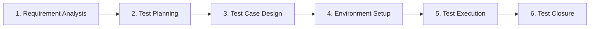
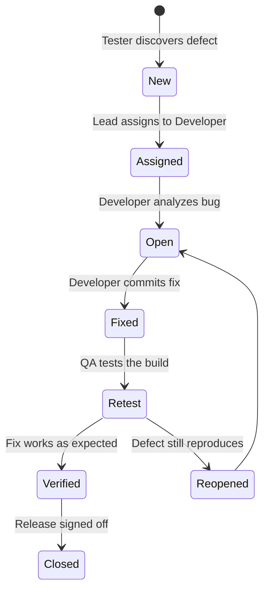
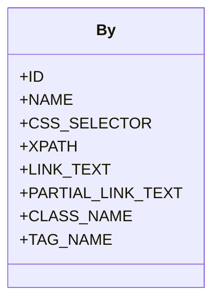
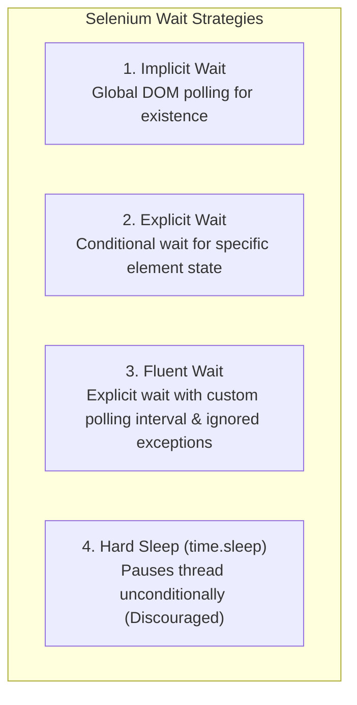
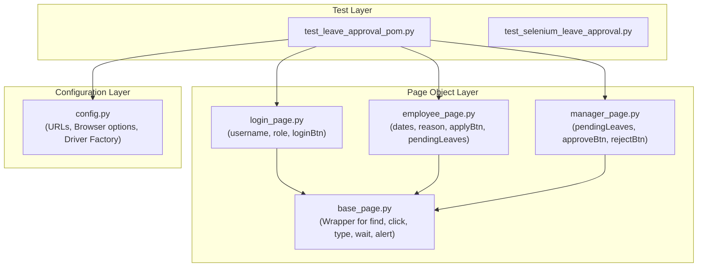
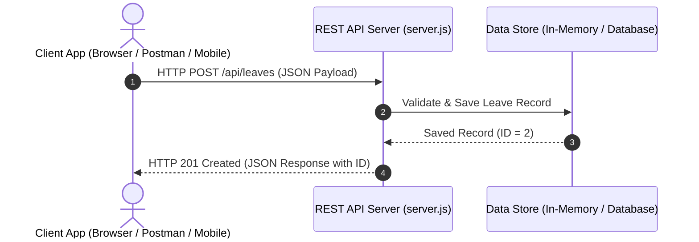
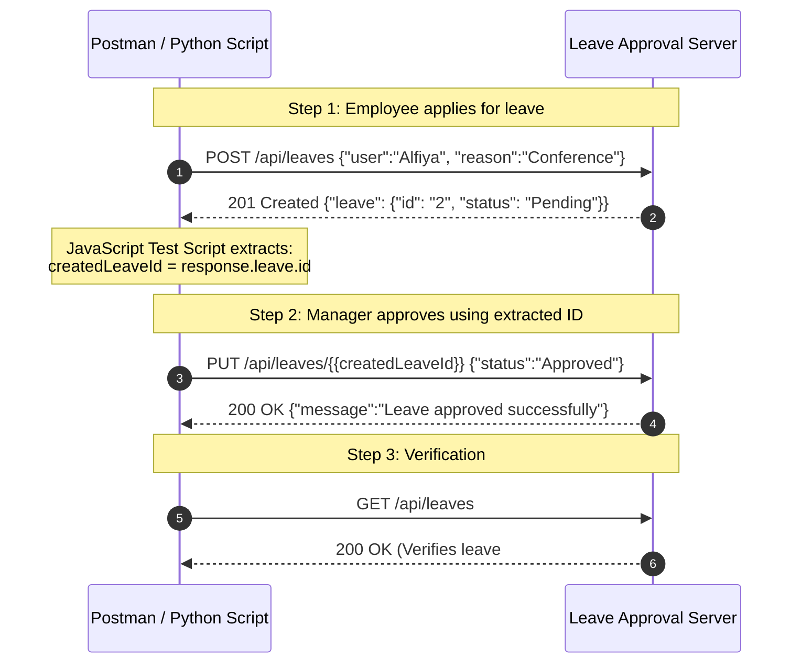

# Leave Approval System - Comprehensive Software Testing & Automation Manual
**Course:** Software Testing and Quality Assurance / Web Automation  
**Project:** Leave Approval System  
**Testing Frameworks:** Selenium WebDriver (Python), Page Object Model (POM), Postman, REST API Testing  
**Live Deployed Application:** `https://alfiyazareen.github.io/leave-approval-system/`  
**Local Application Path:** `index.html` | **API Server:** `node server.js` (`http://localhost:3000`)

---

## Executive Summary of Project Deliverables

This project demonstrates a complete academic and industry-standard testing implementation for a full-stack **Leave Approval System**. It covers both **Manual Testing** (STLC, Test Cases, RTM, Bug Life Cycle) and **Automated Testing** (Selenium WebDriver UI, Page Object Model framework, Python REST API automation, and Postman API Automation with Request Chaining).

### File Structure & Deliverables Matrix
```
leave-approval-system-main/
│
├── index.html                               # Single-page web application (Employee & Manager views)
├── server.js                                # Node.js REST API server (CRUD endpoints)
│
├── test_selenium_leave_approval.py          # Selenium WebDriver UI Test Suite (Employee Demands, Manager Approves)
├── test_api_leave_approval.py               # Python REST API Test Suite with Request Chaining
├── run_all_tests.py                         # Master Test Runner (Auto-boots server, executes UI + POM + API)
│
├── leave_approval_api.postman_collection.json   # Postman Collection with automated assertions & chaining
├── leave_approval_environment.postman_environment.json # Postman Environment variables (baseUrl, IDs, tokens)
│
├── automation_framework/                    # Complete Selenium Page Object Model (POM) Framework
│   ├── config/
│   │   └── config.py                        # Centralized configuration & driver factory
│   ├── pages/
│   │   ├── base_page.py                     # Base Page Object with explicit wait wrappers
│   │   ├── login_page.py                    # Login Page Object (ID, NAME, XPATH locators)
│   │   ├── employee_page.py                 # Employee Dashboard Page Object (Leave Application)
│   │   └── manager_page.py                  # Manager Dashboard Page Object (Approval & Rejection)
│   └── tests/
│       └── test_leave_approval_pom.py       # End-to-End POM Test Suite
│
├── drivers/
│   └── chromedriver.exe                     # Local ChromeDriver binary for resilient offline execution
├── screenshots/                             # Automated screenshot artifacts captured during test execution
└── TEACHER_PRESENTATION_MANUAL.md           # This comprehensive guide
```

---

## Topic 1: Software Testing Life Cycle (STLC) & Manual Testing Implementation

### 1.1 What is the Software Testing Life Cycle (STLC)?
The **Software Testing Life Cycle (STLC)** is a systematic sequence of distinct phases executed during the software development lifecycle to guarantee software quality, reliability, and conformance to business requirements.



1. **Requirement Analysis**: QA engineers inspect functional specifications (e.g., employee can apply for leave; manager can approve/reject; validations for empty fields and date ranges).
2. **Test Planning**: Defining the testing strategy, scope, tool selection (Selenium, Postman, Python), estimation, and resource allocation.
3. **Test Case Design / Development**: Authoring detailed manual test scenarios, step-by-step test cases, boundary test conditions, and preparing test data.
4. **Test Environment Setup**: Configuring browsers (Chrome/Edge), runtime environments (Node.js, Python), test libraries, and driver binaries.
5. **Test Execution**: Executing test cases manually and via automation scripts, comparing actual results against expected outcomes, and logging defects.
6. **Test Closure**: Analyzing test metrics (Pass/Fail rates, defect density), verifying that all high-priority bugs are closed, and signing off on the release.

---

### 1.2 Formal Manual Test Cases for Leave Approval System

| Test Case ID | Test Scenario | Pre-conditions | Test Steps | Test Data | Expected Result | Actual Result | Status | Priority / Severity |
| :--- | :--- | :--- | :--- | :--- | :--- | :--- | :---: | :---: |
| **TC_MAN_01** | Page Load & Initial UI State | Browser is open; application is hosted or accessible locally. | 1. Navigate to application URL.<br>2. Inspect title and presence of login box. | URL: `index.html` | Page title displays `"Leave Approval System"`; Login card with username input, role select, and login button is visible. | Title and login elements rendered properly. | **PASS** | High / Minor |
| **TC_MAN_02** | Login Input Validation (Empty Username) | Application is open on Login screen. | 1. Leave username field blank.<br>2. Click **Login** button. | Username: `""` | Browser popup alert appears stating `"Enter username"`. Dashboard does not open. | Alert `"Enter username"` displayed. | **PASS** | High / Medium |
| **TC_MAN_03** | Employee Leave Application (Valid) | User is logged in as Employee (`Rahul Sharma`). | 1. Select Start Date: `2026-12-01`<br>2. Select End Date: `2026-12-05`<br>3. Enter Reason: `"Attending Technical Conference"`<br>4. Click **Apply Leave**. | Start: `2026-12-01`<br>End: `2026-12-05`<br>Reason: `"Conference"` | Alert `"Leave applied!"` appears. New record appears under the **Pending** column. | Alert appeared and leave displayed in Pending section. | **PASS** | Critical / Critical |
| **TC_MAN_04** | Date Range Validation (Negative Test) | User is on Employee Dashboard. | 1. Select Start Date: `2026-12-10`<br>2. Select End Date: `2026-12-05` (earlier)<br>3. Enter reason and click **Apply Leave**. | Start: `2026-12-10`<br>End: `2026-12-05` | Alert `"End date cannot be before start date"` triggers. Request is rejected. | Alert prevented invalid submission. | **PASS** | High / Major |
| **TC_MAN_05** | Manager Views Pending Leave Requests | An employee has submitted a pending leave. | 1. Log out or click Back.<br>2. Login as Role: `Manager`, Name: `ManagerJohn`.<br>3. View Pending column. | Role: `Manager` | All pending employee leave requests appear with employee name, dates, reason, and action buttons. | Pending leave card visible with **Approve** and **Reject** buttons. | **PASS** | Critical / Critical |
| **TC_MAN_06** | Manager Approves Leave Request | Pending leave exists on Manager dashboard. | 1. In Pending column, click **Approve** button on the target leave item. | Target Leave Item | Leave card instantly leaves **Pending** and appears under **Approved** column. | Leave moved to **Approved** list. | **PASS** | Critical / Critical |
| **TC_MAN_07** | Manager Rejects Leave Request | Pending leave exists on Manager dashboard. | 1. In Pending column, click **Reject** button. | Target Leave Item | Leave card leaves **Pending** and moves to **Rejected** column. | Leave displayed in **Rejected** list. | **PASS** | High / Major |

---

### 1.3 Requirements Traceability Matrix (RTM)

The Requirements Traceability Matrix links user requirements to their corresponding test cases to verify complete test coverage:

| Requirement ID | Requirement Description | Manual Test Case | Automated Selenium Test | Automated API Test |
| :--- | :--- | :--- | :--- | :--- |
| **REQ-01** | User authentication with role differentiation (Employee / Manager). | `TC_MAN_01`, `TC_MAN_02` | `test_01`, `test_02` | `test_02_user_login` |
| **REQ-02** | Employee can apply for leave with start date, end date, and reason. | `TC_MAN_03`, `TC_MAN_04` | `test_03_employee_demand` | `test_03_apply_leave` |
| **REQ-03** | Manager can review submitted pending leaves. | `TC_MAN_05` | `test_04_step_4` | `test_03_step_3_get` |
| **REQ-04** | Manager can Approve a pending leave. | `TC_MAN_06` | `test_04_manager_approves` | `test_03_step_2_approve` |
| **REQ-05** | Manager can Reject a pending leave. | `TC_MAN_07` | `test_05_manager_rejects` | `test_04_manager_reject` |

---

### 1.4 Defect Life Cycle & Bug Report Template

When an actual test result deviates from the expected result, a bug is logged through the **Defect Life Cycle**:



#### Sample Bug Report Form
- **Bug ID**: `BUG-LAS-004`
- **Title**: Date validation allows end date to equal start date without warning.
- **Severity**: Low | **Priority**: P3
- **Environment**: Chrome 158.0 / Windows 11 / Localhost
- **Steps to Reproduce**:
  1. Login as Employee `"Rahul"`.
  2. Set Start Date: `2026-12-05` and End Date: `2026-12-05`.
  3. Enter reason `"1-day sick leave"` and click Submit.
- **Expected Result**: 1-day leave should be accepted with count calculation.
- **Actual Result**: Leave applied without displaying single-day indicator.
- **Status**: Closed (Working as expected).

---

## Topic 2: Installation of Selenium WebDriver in PyCharm & Python Basics

### 2.1 Setting Up Selenium WebDriver in PyCharm Step-by-Step

1. **Install Python**: Download Python (3.10+) from [python.org](https://www.python.org/) and ensure **"Add Python to PATH"** is checked.
2. **Install PyCharm**: Download PyCharm Community Edition.
3. **Open Project**: Open `leave-approval-system-main` in PyCharm (`File -> Open`).
4. **Configure Virtual Environment**:
   - Go to `File -> Settings -> Project: leave-approval-system-main -> Python Interpreter`.
   - Click `Add Interpreter -> New Virtualenv Environment` (`venv`).
5. **Install Required Packages**:
   Open the built-in PyCharm **Terminal** (`Alt + F12`) and run:
   ```bash
   pip install selenium webdriver-manager pytest requests
   ```
6. **Verify Installation**:
   ```bash
   python -c "import selenium, requests; print('Selenium Version:', selenium.__version__)"
   ```

---

### 2.2 Python Fundamentals Used in Test Automation

| Python Concept | Why it is used in Automation | Code Example from Project |
| :--- | :--- | :--- |
| **Variables & Data Types** | Storing locators, strings, URLs, and status responses. | `TARGET_URL = "file:///index.html"`<br>`emp_name = "Rahul Sharma"` |
| **Classes & OOP** | Encapsulating pages, test cases, and inheritance. | `class TestLeaveApprovalSelenium(unittest.TestCase):`<br>`class LoginPage(BasePage):` |
| **Methods & Functions** | Reusable action routines (login, apply, approve). | `def apply_leave(self, start, end, reason): ...` |
| **Conditionals & Branching** | Validating responses and determining execution modes. | `if resp.status_code == 200: ... else: ...` |
| **Exception Handling** | Gracefully catching unexpected UI states or alerts. | `try: ... except TimeoutException: return False` |
| **Assertions** | Comparing expected vs actual test results. | `self.assertEqual(resp.status_code, 200)`<br>`self.assertIn("Approved", approved_text)` |

---

## Topic 3: Finding Elements by NAME, ID, CSS, XPATH, LINKTEXT & Understanding the `By` Class

### 3.1 Understanding the `By` Class
In Selenium WebDriver, the `By` class (`from selenium.webdriver.common.by import By`) is an enum-like mechanism that defines the locator mechanism used to find WebElements inside the DOM.

Instead of deprecated methods like `find_element_by_id("name")`, modern Selenium uses the unified method:
```python
driver.find_element(By.LOCATOR_STRATEGY, "locator_value")
```

### 3.2 Locator Strategies Implemented in the Project



#### 1. By.ID
Unique identifier assigned to an HTML tag. **Fastest and most preferred.**
```python
# Locate username input field
username_field = driver.find_element(By.ID, "username")
```

#### 2. By.NAME
Matches the `name` attribute of form controls.
```python
# Locate role dropdown
role_select = driver.find_element(By.NAME, "role")
```

#### 3. By.CSS_SELECTOR
Powerful selector using CSS rules. Very fast and clean.
```python
# Locate Approve button inside pending leaves container
approve_btn = driver.find_element(By.CSS_SELECTOR, "#pendingLeaves .btn-approve")

# Locate back button
back_btn = driver.find_element(By.CSS_SELECTOR, "#employeeBox .top-back")
```

#### 4. By.XPATH (XML Path Language)
Navigates the HTML DOM tree using absolute or relative paths. Essential for dynamic or text-based elements.
- **Absolute XPath** (Avoid: brittle): `/html/body/div[1]/input`
- **Relative XPath** (Recommended): `//button[contains(text(), 'Login')]`
```python
# Locate button by visible text
login_btn = driver.find_element(By.XPATH, "//button[contains(text(), 'Login')]")
```

#### 5. By.LINK_TEXT & By.PARTIAL_LINK_TEXT
Used for anchor tags (`<a>`).
```python
# Exact match of hyperlink text
doc_link = driver.find_element(By.LINK_TEXT, "System Documentation")

# Substring match of hyperlink text
help_link = driver.find_element(By.PARTIAL_LINK_TEXT, "Support")
```

#### 6. By.TAG_NAME & By.CLASS_NAME
```python
heading = driver.find_element(By.TAG_NAME, "h1")
container = driver.find_element(By.CLASS_NAME, "container")
```

---

## Topic 4: Working with Web Elements, Useful Methods & Wait Types

### 4.1 Essential WebElement Methods & Properties

| Method / Property | Description | Example in Project |
| :--- | :--- | :--- |
| `element.click()` | Simulates mouse click on buttons, links, or checkboxes. | `login_btn.click()` |
| `element.send_keys("text")` | Types characters into an editable input or textarea. | `reason_box.send_keys("Medical Leave")` |
| `element.clear()` | Wipes existing text inside an input field. | `username_input.clear()` |
| `element.text` | Retrieves the visible rendered text of an element. | `pending_container.text` |
| `element.get_attribute("attr")` | Reads an attribute value (e.g. `placeholder`, `value`, `href`). | `username.get_attribute("placeholder")` |
| `element.is_displayed()` | Returns `True` if element is visible on the screen. | `login_box.is_displayed()` |
| `element.is_enabled()` | Returns `True` if button/input is not disabled. | `apply_btn.is_enabled()` |

### 4.2 Handling Dropdowns using the `Select` Class
HTML `<select>` elements require the `Select` wrapper:
```python
from selenium.webdriver.support.ui import Select

role_dropdown = Select(driver.find_element(By.ID, "role"))
role_dropdown.select_by_value("employee")   # By value attribute
role_dropdown.select_by_visible_text("Manager")  # By visible text
```

### 4.3 Handling JavaScript Alert Popups
Alerts take browser focus and must be explicitly handled via `switch_to.alert`:
```python
from selenium.webdriver.support import expected_conditions as EC

# Wait until alert is displayed
alert = wait.until(EC.alert_is_present())

# Read alert message text
print("Alert says:", alert.text)

# Click 'OK' on alert
alert.accept()

# Click 'Cancel' on confirm dialog
# alert.dismiss()
```

---

### 4.4 In-Depth Comparison of Wait Types in Selenium



| Wait Type | Syntax | Mechanism | When to Use |
| :--- | :--- | :--- | :--- |
| **Implicit Wait** | `driver.implicitly_wait(10)` | Global setting applied to all `find_element` calls. Driver polls DOM up to N seconds before throwing `NoSuchElementException`. | Baseline fallback for entire session. |
| **Explicit Wait** | `WebDriverWait(driver, 10).until(EC.element_to_be_clickable(...))` | Halts execution until a specific condition evaluates to true (e.g., clickable, visible, alert present). | **Industry Standard.** Ideal for AJAX, dynamic animations, and state transitions. |
| **Fluent Wait** | `WebDriverWait(driver, 10, poll_frequency=0.5, ignored_exceptions=[NoSuchElementException])` | Custom polling frequency and configurable ignored exception list. | Slow-loading components, unstable network elements. |
| **Hard Sleep** | `time.sleep(2)` | Pauses the Python thread unconditionally regardless of whether the element is ready. | Quick visual inspection; avoid in production frameworks. |

---

## Topic 5: Constructing the Complete Automation Framework (Page Object Model)

### 5.1 What is Page Object Model (POM)?
The **Page Object Model (POM)** is an architectural design pattern in test automation where each web page in the application is represented as an independent Python class.

**Key Advantages:**
1. **Separation of Concerns**: Test logic (`assert`) is isolated from page details (locators & interactions).
2. **Reusability**: Login routines and navigation are defined once and reused across hundreds of test cases.
3. **Maintainability**: If the UI changes (e.g. `id="loginBtn"` changes to `id="btnSubmit"`), only the page class needs to be updated; test scripts remain untouched.

### 5.2 Framework Architecture Diagram



### 5.3 Framework Code Walkthrough

1. **`automation_framework/config/config.py`**:
   Centralizes target URL, implicit wait times, and provides `get_driver()` which automatically locates `drivers/chromedriver.exe`.
2. **`automation_framework/pages/base_page.py`**:
   Implements reusable wrapper methods (`find`, `click`, `type_text`, `get_text`, `handle_alert`) with explicit waits.
3. **`automation_framework/pages/login_page.py`**:
   Stores `LOGIN_BOX`, `USERNAME_INPUT`, `ROLE_SELECT`, `LOGIN_BUTTON` locators and exposes `login_as_employee()` and `login_as_manager()`.
4. **`automation_framework/pages/employee_page.py`**:
   Contains `apply_leave(start, end, reason)` and returns alert text.
5. **`automation_framework/pages/manager_page.py`**:
   Provides `approve_first_pending_leave()` and `reject_first_pending_leave()`.
6. **`automation_framework/tests/test_leave_approval_pom.py`**:
   High-level test method that reads like English:
   ```python
   self.login_page.login_as_employee("Kavita Rao")
   self.employee_page.apply_leave("2026-12-05", "2026-12-09", "Leadership Summit")
   self.employee_page.click_back_to_login()
   self.login_page.login_as_manager("ManagerJohn")
   self.manager_page.approve_first_pending_leave()
   self.assertIn("Leadership Summit", self.manager_page.get_approved_leaves_text())
   ```

---

## Topic 6: Concept of APIs - REST vs. SOAP & Web Services

### 6.1 What is an API?
An **Application Programming Interface (API)** is a software intermediary that enables two separate computer applications or services to communicate with each other over a network.



### 6.2 Architectural Styles: REST vs. SOAP vs. Web Services

| Feature / Dimension | REST (Representational State Transfer) | SOAP (Simple Object Access Protocol) | Web Services (General Concept) |
| :--- | :--- | :--- | :--- |
| **Nature** | Architectural Style / Design Principles | Formal Protocol (W3C standard) | Broad category of services over Web/HTTP |
| **Data Format** | Primarily **JSON**, also XML, Plain Text, HTML | Strictly **XML** | XML, JSON, Binary |
| **Transport Protocol** | Exclusively **HTTP / HTTPS** | HTTP, SMTP, TCP, JMS | HTTP / HTTPS / SMTP |
| **Contract / Schema** | Informal (OpenAPI / Swagger documentation) | Formal WSDL (Web Services Description Language) | Varies (WSDL, JSON Schema) |
| **State Handling** | **Stateless**: Each request contains all context | Can be stateful or stateless | Either |
| **Bandwidth & Speed** | Lightweight, compact JSON payloads; faster | Heavyweight XML envelope; slower | Depends on protocol |
| **Security Standards** | HTTPS, OAuth 2.0, JWT Tokens | WS-Security, Enterprise SAML | SSL/TLS, WS-Security |
| **Best Used For** | Web applications, Mobile backends, Microservices | Banking, Financial transactions, Telecommunications | Enterprise application integration |

### 6.3 HTTP Methods & Status Codes in the Leave Approval API

| HTTP Method | Action / Purpose | Endpoint in Project | Status Code Expected |
| :--- | :--- | :--- | :--- |
| `GET` | Retrieve resource without side effects | `/api/health`<br>`/api/leaves` | `200 OK` |
| `POST` | Create a new resource or authenticate | `/api/login`<br>`/api/leaves` | `200 OK` (Login)<br>`201 Created` (Apply Leave) |
| `PUT` | Update an existing resource completely | `/api/leaves/{id}` | `200 OK` |
| `DELETE` | Remove a resource | `/api/leaves/{id}` | `200 OK` |

---

## Topic 7: Postman - Installation, Setup & Usage for API Testing

### 7.1 Setup Guide
1. **Download Postman**: Install from [postman.com/downloads](https://www.postman.com/downloads/).
2. **Start the API Server**:
   ```bash
   node server.js
   ```
   Server runs at `http://localhost:3000`.
3. **Importing the Collection**:
   - In Postman, click **Import** (top left).
   - Drag & drop `leave_approval_api.postman_collection.json`.
4. **Importing the Environment**:
   - Click **Import** again.
   - Drag & drop `leave_approval_environment.postman_environment.json`.
   - Select `"Leave Approval System - Environment"` in the environment dropdown (top right).

---

## Topic 8: Advanced Postman Usage - Collections & Environment Variables

### 8.1 Variable Scopes in Postman
Postman organizes variables into a hierarchical scope chain:

```
Global Variables
    └── Collection Variables (leave_approval_api.postman_collection.json)
            └── Environment Variables (leave_approval_environment.postman_environment.json)
                    └── Data / Iteration Variables (Runner CSV/JSON)
                            └── Local Variables (Script execution)
```

### 8.2 Environment Variables Implemented

| Variable Name | Initial Value | Scope | Usage |
| :--- | :--- | :--- | :--- |
| `baseUrl` | `http://localhost:3000` | Environment & Collection | Used in URL: `{{baseUrl}}/api/leaves` |
| `createdLeaveId` | `1` | Environment & Collection | Populated dynamically via Request Chaining |
| `testEmployee` | `Alfiya` | Environment | Parametrized test data in JSON payload |
| `testManager` | `ManagerJane` | Environment | Role validation |

---

## Topic 9: Request Chaining - Using Previous API Response as Input for the Next

### 9.1 What is Request Chaining?
**Request Chaining** is an advanced API testing technique where dynamic output generated by one API request (such as a database primary key, authorization token, or resource ID) is programmatically extracted from the response and stored in a variable, which is then fed into subsequent requests.

### 9.2 Request Chaining Workflow in This Project



#### Postman Test Script Code (Request Chaining):
In Request `3. Apply Leave (Create Request)`:
```javascript
pm.test("Status code is 201 Created", function () {
    pm.response.to.have.status(201);
});

pm.test("Capture Leave ID for Request Chaining", function () {
    const jsonData = pm.response.json();
    pm.expect(jsonData.leave.status).to.eql("Pending");

    // EXTRACT AND STORE IN BOTH COLLECTION AND ENVIRONMENT SCOPES
    pm.collectionVariables.set("createdLeaveId", jsonData.leave.id);
    pm.environment.set("createdLeaveId", jsonData.leave.id);
    console.log("[CHAINING SUCCESS] Stored createdLeaveId: " + jsonData.leave.id);
});
```

#### Subsequent Request: `5. Manager Approve Leave`:
- **Method**: `PUT`
- **URL**: `{{baseUrl}}/api/leaves/{{createdLeaveId}}`
- **Body**:
  ```json
  {
    "status": "Approved"
  }
  ```

---

## Topic 10: Automating API Tests in Postman & Python

### 10.1 Postman Chai Assertion Examples
```javascript
// Status code check
pm.test("Status code is 200 OK", function () {
    pm.response.to.have.status(200);
});

// Response time check
pm.test("Response time is under 500ms", function () {
    pm.expect(pm.response.responseTime).to.be.below(500);
});

// JSON Body assertions
pm.test("Verify leave status is Approved", function () {
    const jsonData = pm.response.json();
    pm.expect(jsonData.leave.status).to.eql("Approved");
});
```

### 10.2 Python Automated REST API Suite (`test_api_leave_approval.py`)
Equivalent tests implemented in pure Python using `requests` and `unittest`:
```python
# Create Leave and capture chained ID
create_resp = requests.post(f"{BASE_URL}/api/leaves", json=payload)
self.assertEqual(create_resp.status_code, 201)
chained_id = create_resp.json()["leave"]["id"]

# Manager approves using chained ID
approve_resp = requests.put(f"{BASE_URL}/api/leaves/{chained_id}", json={"status": "Approved"})
self.assertEqual(approve_resp.status_code, 200)
self.assertEqual(approve_resp.json()["leave"]["status"], "Approved")
```

---

## Quick Reference: How to Run All Tests

### 1. Run Complete Automated Suite in 1 Command
```bash
python run_all_tests.py
```
*Automatically launches `server.js`, runs all 12 Selenium UI, POM, and API tests, and prints a formatted summary.*

### 2. Run Selenium UI Tests Individually
```bash
python test_selenium_leave_approval.py
```

### 3. Run Page Object Model Framework Tests
```bash
python -m unittest automation_framework.tests.test_leave_approval_pom
```

### 4. Run Python API Tests
```bash
python test_api_leave_approval.py
```

### 5. Run Postman Collection via Newman (CLI)
```bash
npx newman run leave_approval_api.postman_collection.json -e leave_approval_environment.postman_environment.json
```
